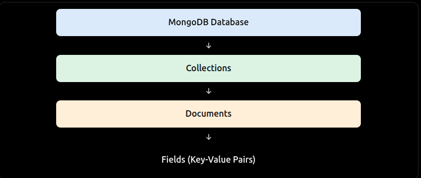

# Nabeel Hasan
## 24EMDT7060
## Big Data Analytics Assignment

<div style="page-break-after: always;"></div>


## **Answer 1**

MongoDB is an open-source, NoSQL database management system designed to store, manage, and process large volumes of structured, semi-structured, and unstructured data. Unlike relational databases that store data in tables and rows, MongoDB uses a flexible document-oriented structure based on JSON-like documents (BSON format).

MongoDB is widely used in modern applications because of its flexibility, scalability, high performance, and ability to handle large datasets.

MongoDB organizes data into the following main components:

1. Database: A database is a container that holds collections. An application can have multiple databases to organize different types of information.

2. Collection: A collection is a group of related documents, similar to a table in a relational database. Unlike relational tables, collections do not require a fixed schema.

3. Document: A document is the basic unit of data in MongoDB. It stores information in key-value pairs using BSON (Binary JSON) format.

4. Fields: Fields represent individual attributes within a document, such as name, age, and city. Each field contains a key and its corresponding value.

5. Indexes: Indexes improve query performance by allowing MongoDB to locate documents efficiently without scanning the entire collection.

The basic structure can be represented as:




**Replication in MongoDB**

Replication is the process of maintaining multiple copies of the same data across different database servers. MongoDB uses a mechanism called a Replica Set to provide data redundancy and high availability.

A replica set generally consists of:
- Primary Node: Handles write operations and records changes to the data.
- Secondary Nodes: Maintain copies of the primary node's data by replicating changes from it.
- Arbiter (Optional): Participates in elections but does not store data. It helps determine which node should become primary.

Importance of Replication:
1. High Availability: If the primary server fails, one of the secondary servers can automatically become the new primary.
2. Data Redundancy: Multiple copies of data protect against data loss caused by hardware or server failures.
3. Fault Tolerance: The database can continue operating even when one of its servers becomes unavailable.
4. Read Scalability: Read operations can be distributed across secondary nodes when appropriate, reducing the workload on the primary node.

**Sharding in MongoDB**
Sharding is a technique used to distribute large datasets across multiple servers. It allows MongoDB to handle datasets that are too large or workloads that are too demanding for a single server.

MongoDB divides data into smaller portions called chunks and distributes them across multiple servers known as shards.

The main components of sharding include:
- Shards: Store different portions of the dataset. Each shard is commonly deployed as a replica set.
- Config Servers: Store metadata and configuration information about the sharded cluster.
- Mongos Router: Directs client requests to the appropriate shards based on the shard key and cluster metadata.

Importance of Sharding:
1. Horizontal Scalability: It allows organizations to increase database capacity by adding more servers instead of relying on a single powerful machine.
2. Improved Performance: Data and workloads are distributed across multiple servers, allowing operations to be processed in parallel.
3. Large Dataset Management: It enables MongoDB to store and manage massive amounts of data across multiple machines.
4. Load Distribution: It distributes read and write workloads across different shards, reducing pressure on individual servers.
5. Resource Optimization: It makes efficient use of available storage, memory, and processing resources.

<div style="page-break-after: always;"></div>


## **Answer 2**

**Aggregation in MongoDB**

Aggregation in MongoDB is a process used to analyze and transform data stored in a database. It allows users to perform operations such as filtering, grouping, sorting, calculating averages, counting records, and summarizing large datasets.

Aggregation is particularly useful when working with large collections because it helps extract meaningful information from raw data.

For example, an e-commerce company can use MongoDB aggregation to calculate total sales, average order value, number of orders, and sales by product category.

MongoDB provides two major approaches to data analysis:
1. Aggregation Pipeline
2. MapReduce Functions

Aggregation Pipeline
The Aggregation Pipeline is MongoDB's primary framework for processing and analyzing data. It consists of multiple stages that are executed sequentially to filter, transform, group, and summarize documents.

Important stages of the Aggregation Pipeline:
1. $match: Filters documents based on specified conditions.
2. $group: Groups documents based on a particular field and performs calculations such as sum, average, and count.
3. $sort: Sorts the resulting documents in ascending or descending order.
4. $project: Selects, excludes, or creates specific fields in the output.
5. $limit: Restricts the number of documents returned.
6. $unwind: Deconstructs an array field into multiple individual documents.


Explanation:
- $group groups products according to their category.
- $sum calculates the total sales value for each category.
- $avg calculates the average product price.
- $sort arranges categories according to total sales in descending order.

The Aggregation Pipeline is efficient and suitable for most common data analysis operations.

**MapReduce Functions in MongoDB**

MapReduce is a data processing technique used to analyze large datasets by dividing the processing into two main functions: Map and Reduce.

It follows a key-value processing approach.

Main components of MapReduce:
1. Map Function: Processes individual documents and generates key-value pairs based on specified conditions.
2. Reduce Function: Combines values associated with the same key to generate summarized results.
3. Finalize Function (Optional): Performs additional processing on the final results.

Explanation:
- The Map function extracts the category and price from each document.
- The emit() function generates key-value pairs.
- The Reduce function adds all prices belonging to the same category.
- The final result is stored in the sales_summary collection.

MapReduce is useful for custom data processing tasks that require complex operations beyond standard aggregation capabilities. However, MongoDB deprecated its MapReduce functions starting with version 5.0 and recommends using the Aggregation Pipeline instead.

Advantages of Aggregation Pipeline

- High Performance: Provides optimized data processing and efficient execution.
- Flexibility: Supports multiple operations such as filtering, grouping, sorting, and data transformation.
- Easy Implementation: Uses predefined stages, making queries easier to understand and maintain.
- Scalability: Supports aggregation on large datasets, including sharded collections.
- Resource Efficiency: Allows unnecessary documents and fields to be filtered out early in the pipeline.

Limitations of MapReduce

- Lower Performance: MapReduce generally requires more processing overhead than the Aggregation Pipeline.
- Complex Implementation: Requires writing separate JavaScript functions for mapping and reducing data.
- Maintenance Difficulty: Custom functions can make queries harder to understand and maintain.
- Deprecation: MongoDB deprecated MapReduce starting with version 5.0, making it unsuitable for new applications.

Aggregation is an important feature of MongoDB that allows users to analyze, process, and summarize large datasets efficiently.

The Aggregation Pipeline uses multiple stages to perform operations such as filtering, grouping, sorting, and calculating statistical values. MapReduce uses Map and Reduce functions to process data through key-value pairs.

<div style="page-break-after: always;"></div>


## **Answer 3**

**Streaming Analytics**

Streaming Analytics is the process of continuously collecting, processing, and analyzing data as it is generated. Unlike traditional batch processing, which analyzes data in groups at scheduled intervals, streaming analytics processes data in real time or near real time.

It helps organizations make faster decisions by identifying patterns, trends, and important events as they occur.

For example, an e-commerce company can use streaming analytics to monitor customer purchases, track inventory levels, detect fraudulent transactions, and analyze website activity in real time.

Apache Cassandra is a distributed NoSQL database designed to handle large volumes of data across multiple servers. Its high availability, scalability, fault tolerance, and high write throughput make it suitable for storing real-time streaming data.

**How Streaming Analytics Works**

1. Data Generation: Data is generated continuously from sources such as IoT devices, websites, mobile applications, and sensors.
2. Data Collection: The generated data is collected using streaming platforms such as Apache Kafka.
3. Data Processing: Streaming engines process incoming data to filter, transform, and analyze it.
4. Data Storage: Processed data is stored in databases such as Cassandra for further analysis.
5. Real-Time Insights: The results are used for monitoring, reporting, and making immediate business decisions.

**Example**: In an online shopping platform, every customer click, purchase, and payment generates data. Streaming analytics processes these events to monitor sales, detect suspicious transactions, and update dashboards in real time.

**Apache Cassandra**

Apache Cassandra is an open-source, distributed NoSQL database designed to manage large amounts of data across multiple commodity servers.

It uses a wide-column data model and supports high-speed read and write operations. Cassandra is particularly useful for applications that generate continuous data, such as IoT systems, financial transactions, monitoring systems, and real-time analytics platforms.

1. High Scalability- Cassandra supports horizontal scalability, meaning additional servers can be added to a cluster to increase storage capacity and processing capabilities.As streaming applications generate more data, organizations can add more nodes without depending on a single powerful server.
2. High Availability- Cassandra is designed to remain available even when individual nodes fail. Data is distributed across multiple nodes, allowing the system to continue handling requests during server failures. This feature is important for real-time applications where downtime can result in lost data and interrupted services.
3. Fault Tolerance- Cassandra provides fault tolerance through data replication. Multiple copies of data are maintained across different nodes. If one node becomes unavailable, another node containing a copy of the data can continue serving requests.
4. High Write Throughput-One of Cassandra's most important features is its ability to handle a large number of write operations efficiently. Streaming applications continuously generate events, and Cassandra is optimized for handling frequent data insertions and updates.
5. Distributed Architecture-Cassandra follows a peer-to-peer architecture in which all nodes have equal responsibilities. There is no single master node responsible for handling all operations.This architecture distributes workloads across multiple nodes and eliminates a single point of failure.It also helps maintain performance as the system grows.
6. Tunable Consistency-Cassandra provides tunable consistency, allowing applications to choose the required consistency level for read and write operations.
For example:
- ONE: Only one replica needs to respond successfully.
- QUORUM: A majority of replicas must respond successfully.
- ALL: All required replicas must respond successfully.

7. Efficient Data Storage-Cassandra uses a wide-column data model that allows large volumes of structured and semi-structured data to be stored efficiently.It also uses a write-optimized storage architecture based on a Commit Log, Memtable, and SSTables. This architecture helps Cassandra manage continuous data insertion efficiently, making it suitable for streaming workloads.

**Advantages of Cassandra for Streaming Analytics**

- Scalability: Handles increasing data volumes by adding more nodes.
- High Performance: Supports high-speed write operations for continuous data streams.
- Reliability: Replication protects data against individual node failures.
- Availability: Distributed architecture allows operations to continue during failures.
- Flexibility: Tunable consistency supports different application requirements.
- Large Data Handling: Efficiently manages massive amounts of continuously generated data.

Apache Cassandra is suitable for handling real-time streaming data because of its horizontal scalability, high availability, fault tolerance, distributed architecture, and high write throughput.

When integrated with technologies such as Apache Kafka and Apache Spark Streaming, Cassandra provides a reliable storage solution for applications that require continuous data processing and large-scale data management.

<div style="page-break-after: always;"></div>


## **Answer 4**

Collection data types allow multiple values to be stored within a single column of a row. Cassandra provides three main collection types:
1. SET
2. LIST
3. MAP
These collections are useful when an application needs to store multiple related values without creating a separate table for every value.

**SET Data Type**

A SET is a collection of unique values stored in a single column. It does not allow duplicate elements, and the values are unordered

Usefulness of SET:
- Stores unique values without duplication.
- Useful for storing tags, categories, skills, and interests.
- Makes it easy to add or remove individual elements.

```SQL
CREATE TABLE students (
    student_id INT PRIMARY KEY,
    name TEXT,
    skills SET<TEXT>
);
```

Modifying SET Using CQL:

- Adding an element:

```SQL
UPDATE students
SET skills = skills + {'MongoDB'}
WHERE student_id = 1;
```

**LIST Data Type**

A LIST is an ordered collection of elements that allows duplicate values. Elements are stored in a specific sequence and can be accessed using their index positions.

Usefulness of LIST:
- Maintains the order of elements.
- Allows duplicate values.
- Useful for storing ordered information such as scores, messages, and recent activities.

```SQL
CREATE TABLE student_scores (
    student_id INT PRIMARY KEY,
    scores LIST<INT>
);
```
Modifying LIST Using CQL:

- Adding elements to the end:

```SQL
UPDATE student_scores
SET scores = scores + [95]
WHERE student_id = 1;
```

**MAP Data Type**

A MAP is a collection of key-value pairs in which each key is unique and is associated with a value. It is useful when data needs to be stored and retrieved using meaningful keys.

Usefulness of MAP:
- Stores data in key-value pairs.
- Allows efficient access to values using specific keys.
- Useful for storing user settings, product attributes, and configuration details.

```SQL
CREATE TABLE employees (
    employee_id INT PRIMARY KEY,
    name TEXT,
    skills MAP<TEXT, INT>
);
```

Modifying MAP Using CQL:

- Adding a key-value pair:

```SQL
UPDATE employees
SET skills = skills + {'MongoDB': 95}
WHERE employee_id = 101;
```

Although collection data types are useful, they should be used carefully.
1. Collections are best suited for storing relatively small amounts of related data.
2. Very large collections can negatively affect query performance.
3. Lists can create additional complexity because they maintain element positions.
4. Collections are not suitable for storing unlimited or continuously growing datasets.
5. For large or frequently updated datasets, using a separate table is generally a better approach.


<div style="page-break-after: always;"></div>


## **Answer 5**

**Keyspace in Cassandra**

A Keyspace is the primary container for data in Cassandra. It defines how data is replicated across different nodes in a cluster.
When creating a Keyspace, we specify its name and replication strategy.

```SQL
CREATE KEYSPACE keyspace_name
WITH replication = {
    'class': 'SimpleStrategy',
    'replication_factor': 3
};
```

Explanation:
- CREATE KEYSPACE: Creates a new Keyspace.
- college: Name of the Keyspace.
- SimpleStrategy: Replication strategy generally used for single-data-center environments and testing.
- replication_factor: 3: Maintains three copies of the data across the cluster.
For production environments with multiple data centers, NetworkTopologyStrategy is generally recommended.

Selecting a Keyspace 

After creating a Keyspace, we can select it using:

```SQL
USE college;
```

**Table in Cassandra**

A Table is used to store data in rows and columns within a Keyspace. While creating a table, we must define its columns, data types, and primary key. The primary key uniquely identifies each row and determines how data is distributed and organized.

```SQL
CREATE TABLE table_name (
    column1 datatype,
    column2 datatype,
    column3 datatype,
    PRIMARY KEY (column1)
);
```

Suppose we want to create a student table inside the college Keyspace.

```SQL
CREATE TABLE students (
    student_id INT PRIMARY KEY,
    name TEXT,
    age INT,
    department TEXT,
    email TEXT
);
```

Explanation:
- students: Name of the table.
- student_id: Unique identifier for each student.
- name: Stores the student's name.
- age: Stores the student's age.
- department: Stores the department name.
- email: Stores the student's email address.

**Importing Bulk Data Using CSV Files**

Cassandra provides the COPY FROM command in CQLSH to import bulk data from CSV files into a table. CSV (Comma-Separated Values) is a file format used to store tabular data in a simple text format.

Step 1: Create a CSV File
eg. Create a file named students.csv containing the following data

Step 2: Import CSV Data into Cassandra
Execute the following command in CQLSH:

```SQL
COPY college.students
FROM 'students.csv'
WITH HEADER = TRUE;
```
Explanation:
- COPY: Used to import or export data.
- college.students: Specifies the Keyspace and table.
- FROM: Specifies the CSV file location.
- HEADER = TRUE: Indicates that the first row contains column names.
After executing the command, Cassandra imports the CSV records into the students table.

Step 3: Verify Imported Data

```SQL
SELECT * FROM college.students;
```

Exporting Bulk Data Using CSV Files
Cassandra also supports exporting table data into CSV files using the COPY TO command.

This is useful for creating backups, transferring data, and performing external data analysis.

```SQL
COPY keyspace_name.table_name
TO 'filename.csv'
WITH HEADER = TRUE;
```

Explanation:
- COPY: Initiates the export operation.
- college.students: Specifies the table from which data is exported.
- TO: Specifies the destination CSV file.
- HEADER = TRUE: Includes column names in the first row of the exported file.
After execution, Cassandra creates a CSV file containing the table records.

The exported file can be opened using applications such as Microsoft Excel or imported into Python for further analysis.


**Advantages of CSV Import and Export in Cassandra**

1. Bulk Data Transfer: Allows thousands of records to be imported or exported without inserting them individually.
2. Easy Data Migration: Makes it easier to transfer data between different systems.
3. Compatibility: CSV files can be used with Excel, Python, R, and other data analysis tools.
4. Backup and Recovery: Exported CSV files can be retained for backup and later imported when required.
5. Simplicity: The COPY command provides a straightforward method for handling CSV data through CQLSH.


<div style="page-break-after: always;"></div>
