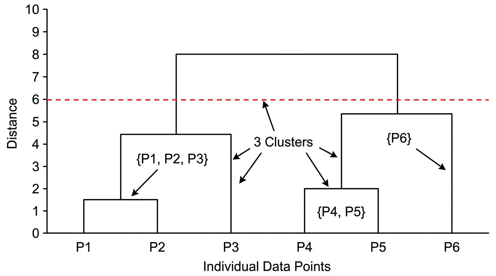
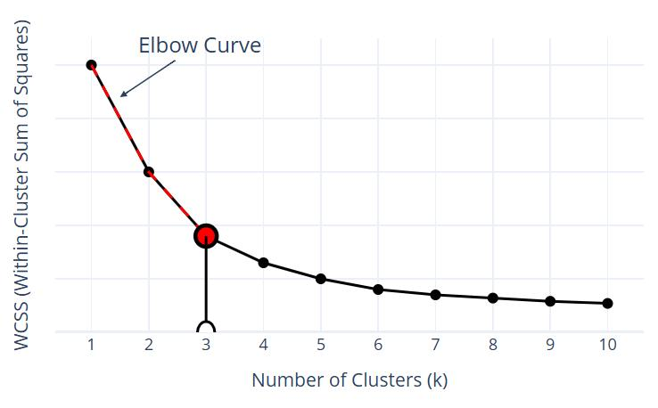

## **Nabeel Hasan**
### **24EMDT7060**
### **ML Assignment**

### **Answer 1**

A Perceptron is a simple artificial neural network used for binary classification. It consists of input values, weights, a bias, and an activation function. The Perceptron learns by adjusting its weights and bias whenever it makes an incorrect prediction.

In this problem, we need to train a single-layer Perceptron to learn the OR logic function using the given training patterns.

The training dataset is:

| Input $x_1$ | Input $x_2$ | Target $t$) |
|:---:|:---:|:---:|
| 0 | 0 | 0 |
| 0 | 1 | 1 |
| 1 | 0 | 1 |
| 1 | 1 | 1 |

Initial parameters:
- Initial weight: $w_1=0$
- Initial weight: $w_2=0$
- Initial bias: $b=0$
- Learning rate: $\eta=1$

The Perceptron learning rules are:

**Weight update rule:**

$$
w_i^{new}=w_i^{old}+\eta(t-y)x_i
$$

**Bias update rule:**

$$
b^{new}=b^{old}+\eta(t-y)
$$

Where:
- $t$ = Actual target output.
- $y$ = Predicted output.
- $\eta$ = Learning rate.
- $x_i$ = Input feature.
- $w_i$ = Weight associated with the input.

Calculate the weighted sum (net input):

$$
net=w_1x_1+w_2x_2+b
$$  

Step activation function:

$$
y=
\begin{cases}
1 & \text{if } net\geq 0\\
0 & \text{if } net<0
\end{cases}
$$

The Perceptron compares the predicted output $y$ with the actual target $t$.
- If $t=y$, no update is required.
- If $t\neq y$, weights and bias are updated using the learning rules.

Train the Perceptron using the four training patterns in the given order. One complete pass through all four patterns is called an epoch.

Epoch 1
Initial values:

$$w_1=0,\quad w_2=0,\quad b=0$$

Pattern 1: (0, 0), Target = 0

Calculate net input:

$$net=(0\times0)+(0\times0)+0=0$$

Since $net\geq0$:

$$y=1$$

Prediction is incorrect because $t=0$ and $y=1$.

Update weights:

$$w_1=0+(0-1)(0)=0$$

$$w_2=0+(0-1)(0)=0$$

Update bias:

$$b=0+(0-1)=-1$$

New parameters:

$$w_1=0,\quad w_2=0,\quad b=-1$$

Pattern 2: (0, 1), Target = 1

Calculate net input:

$$net=(0\times0)+(0\times1)-1=-1$$

Therefore:

$$y=0$$

Prediction is incorrect.

Update weights:

$$w_1=0+(1-0)(0)=0$$

$$w_2=0+(1-0)(1)=1$$

Update bias:

$$b=-1+(1-0)=0$$

New parameters:

$$w_1=0,\quad w_2=1,\quad b=0$$

Pattern 3: (1, 0), Target = 1

$$net=(0\times1)+(1\times0)+0=0$$

$$y=1$$

Prediction is correct. No update is required.

Pattern 4: (1, 1), Target = 1

$$net=(0\times1)+(1\times1)+0=1$$

$$y=1$$

Prediction is correct. No update is required.

At the end of Epoch 1:

$$w_1=0,\quad w_2=1,\quad b=0$$

However, the Perceptron has not yet learned the complete OR function.

Epoch 2
Starting parameters:

$$w_1=0,\quad w_2=1,\quad b=0$$

Pattern 1: (0, 0), Target = 0

$$net=(0\times0)+(1\times0)+0=0$$

$$y=1$$

Prediction is incorrect.

Update:

$$w_1=0+(0-1)(0)=0$$

$$w_2=1+(0-1)(0)=1$$

$$b=0+(0-1)=-1$$

New parameters:

$$w_1=0,\quad w_2=1,\quad b=-1$$

Pattern 2: (0, 1), Target = 1

$$net=(0\times0)+(1\times1)-1=0$$

$$y=1$$

Prediction is correct. No update.

Pattern 3: (1, 0), Target = 1

$$net=(0\times1)+(1\times0)-1=-1$$

$$y=0$$

Prediction is incorrect.

Update:

$$w_1=0+(1-0)(1)=1$$

$$w_2=1+(1-0)(0)=1$$

$$b=-1+(1-0)=0$$

New parameters:

$$w_1=1,\quad w_2=1,\quad b=0$$

Pattern 4: (1, 1), Target = 1

$$net=(1\times1)+(1\times1)+0=2$$

$$y=1$$

Prediction is correct. No update.

At the end of Epoch 2:

$$w_1=1,\quad w_2=1,\quad b=0$$

Epoch 3
Starting parameters:

$$w_1=1,\quad w_2=1,\quad b=0$$

Pattern 1: (0, 0), Target = 0

$$net=(1\times0)+(1\times0)+0=0$$

$$y=1$$

Prediction is incorrect.

Update:

$$w_1=1+(0-1)(0)=1$$

$$w_2=1+(0-1)(0)=1$$

$$b=0+(0-1)=-1$$

New parameters:

$$w_1=1,\quad w_2=1,\quad b=-1$$

Pattern 2: (0, 1), Target = 1

$$net=(1\times0)+(1\times1)-1=0$$

$$y=1$$

Prediction is correct. No update.

Pattern 3: (1, 0), Target = 1

$$net=(1\times1)+(1\times0)-1=0$$

$$y=1$$

Prediction is correct. No update.

Pattern 4: (1, 1), Target = 1

$$net=(1\times1)+(1\times1)-1=1$$

$$y=1$$

Prediction is correct. No update.

At the end of Epoch 3:

$${w_1=1,\quad w_2=1,\quad b=-1}$$

All four training patterns are now classified correctly.

The following table summarizes the weight and bias changes across all three epochs.

| Epoch | Input | Target | Predicted | $w_1$ | $w_2$ | Bias |
|:---:|:---:|:---:|:---:|:---:|:---:|:---:|
| 1 | (0,0) | 0 | 1 | 0 | 0 | -1 |
| 1 | (0,1) | 1 | 0 | 0 | 1 | 0 |
| 1 | (1,0) | 1 | 1 | 0 | 1 | 0 |
| 1 | (1,1) | 1 | 1 | 0 | 1 | 0 |
| 2 | (0,0) | 0 | 1 | 0 | 1 | -1 |
| 2 | (0,1) | 1 | 1 | 0 | 1 | -1 |
| 2 | (1,0) | 1 | 0 | 1 | 1 | 0 |
| 2 | (1,1) | 1 | 1 | 1 | 1 | 0 |
| 3 | (0,0) | 0 | 1 | 1 | 1 | -1 |
| 3 | (0,1) | 1 | 1 | 1 | 1 | -1 |
| 3 | (1,0) | 1 | 1 | 1 | 1 | -1 |
| 3 | (1,1) | 1 | 1 | 1 | 1 | -1 |

Varifying the results

After training, the final parameters are:

$$w_1=1,\quad w_2=1,\quad b=-1$$

The final Perceptron equation is:

$$net=x_1+x_2-1$$

Let's verify all four input combinations.

| $x_1$ | $x_2$ | Net Input | Predicted Output | Actual Output |
|:---:|:---:|:---:|:---:|:---:|
| 0 | 0 | -1 | 0 | 0 |
| 0 | 1 | 0 | 1 | 1 |
| 1 | 0 | 0 | 1 | 1 |
| 1 | 1 | 1 | 1 | 1 |

The single-layer Perceptron successfully learned the OR logic function after three epochs of training. Initially, the weights and bias were set to zero. Whenever the Perceptron produced an incorrect prediction, the weights and bias were adjusted using the Perceptron learning rule.

After three epochs, the final learned parameters were:

$${w_1=1,\quad w_2=1,\quad b=-1}$$

Using these parameters, the Perceptron correctly classifies all four input combinations of the OR logic function.

This demonstrates that a single-layer Perceptron can learn linearly separable logic functions such as AND and OR through iterative weight and bias adjustments.

### **Answer2**

The model is evaluated on a total of 200 financial transactions.

|	|Actual Fraud	|Actual Non-Fraud|
|---|---------------|----------------|
|Predicted Fraud	|36	|14|
|Predicted Non-Fraud	|10	|140|

From the confusion matrix, we identify the following values:
- True Positive (TP) = 36: The model correctly identifies 36 fraudulent transactions.
- False Positive (FP) = 14: The model incorrectly identifies 14 legitimate transactions as fraudulent.
- False Negative (FN) = 10: The model incorrectly identifies 10 fraudulent transactions as legitimate.
- True Negative (TN) = 140: The model correctly identifies 140 legitimate transactions.
Total observations:

$$TP+FP+FN+TN=200$$

$$36+14+10+140=200$$

Accuracy
Accuracy measures the proportion of total predictions that the model classifies correctly.

Formula:

$$Accuracy=\frac{TP+TN}{TP+TN+FP+FN}$$

Substituting the given values:

$$Accuracy=\frac{36+140}{36+140+14+10}$$

$$=\frac{176}{200}$$

$${Accuracy=88\%}$$

**Interpretation**:The model correctly classifies 88% of all financial transactions. This means that out of 200 transactions, 176 are correctly classified as either fraudulent or non-fraudulent.

Precision
Precision measures the proportion of transactions predicted as fraudulent that are actually fraudulent.

$$Precision=\frac{TP}{TP+FP}$$

Substituting the given values:

$$Precision=\frac{36}{36+14}$$

$$=\frac{36}{50}$$

$${Precision=72\%}$$

**Interpretation**: Out of all transactions predicted as fraudulent, 72% are actually fraudulent.The remaining 28% are legitimate transactions incorrectly flagged as fraudulent. Higher precision helps reduce unnecessary investigations and inconvenience to genuine customers.

Recall (Sensitivity)
Recall measures the proportion of actual fraudulent transactions that the model correctly identifies.

$$Recall=\frac{TP}{TP+FN}$$

Substituting the given values:

$$Recall=\frac{36}{36+10}$$

$$=\frac{36}{46}$$

$${Recall=78.26\%}$$

**Interpretation**:The model successfully detects approximately 78.26% of all actual fraudulent transactions.However, it fails to detect approximately 21.74% of fraudulent transactions. These undetected transactions are classified as legitimate, which can result in financial losses.

Specificity
Specificity measures the proportion of actual legitimate transactions that the model correctly identifies as non-fraudulent.

$$Specificity=\frac{TN}{TN+FP}$$

Substituting the given values:

$$Specificity=\frac{140}{140+14}$$

$$=\frac{140}{154}$$

$${Specificity=90.91\%}$$

**Interpretation**:The model correctly identifies approximately 90.91% of legitimate transactions as non-fraudulent.This indicates that the model performs well in identifying genuine transactions and avoids incorrectly flagging most legitimate customers.

F1-Score
The F1-Score is the harmonic mean of Precision and Recall. It provides a balance between these two metrics.

Formula:

$$F1=2\times\frac{Precision\times Recall}
{Precision+Recall}
$$

Substituting the calculated values:

$$
F1=2\times\frac{0.72\times0.7826}
{0.72+0.7826}
$$

$$F1\approx0.75$$

$${F1\text{-}Score=75\%}$$

**Interpretation**:The F1-Score of 75% indicates the balance between the model's ability to identify fraudulent transactions and the accuracy of its fraud predictions.It is particularly useful when both false positives and false negatives need to be considered.

In fraud detection, Recall is particularly important because missing a fraudulent transaction can result in significant financial losses.
Recall measures how effectively the model identifies actual fraudulent transactions.

In this example:
- Total actual fraudulent transactions = 46.
- Correctly detected fraudulent transactions = 36.
- Undetected fraudulent transactions = 10.
Therefore, the model misses 10 fraudulent transactions out of 46 actual fraud cases.

This means approximately 21.74% of fraudulent transactions go undetected.

A higher Recall would reduce the number of missed fraudulent transactions and help minimize financial losses.

However, increasing Recall can sometimes reduce Precision because more legitimate transactions may be incorrectly flagged as fraudulent. Therefore, the organization should balance fraud detection with customer convenience and investigation costs.

The fraud detection classification model achieves an accuracy of 88%, precision of 72%, recall of 78.26%, specificity of 90.91%, and an F1-Score of 75%.

The model performs well in identifying legitimate transactions, as indicated by its high specificity of 90.91%. However, its recall of 78.26% indicates that some fraudulent transactions are still going undetected.

Among all the evaluation metrics, Recall is particularly important in fraud detection because failing to identify fraudulent transactions can cause significant financial losses.

Therefore, the model should be further improved to increase Recall while maintaining reasonable Precision. This would help detect more fraudulent transactions without unnecessarily flagging legitimate customers.

### **Answer 3**
The following observations are available:

|Employee	|Training Hours (X)	|Productivity Score (Y)|
|---|---|---|
|E1	|2	|50|
|E2	|4	|60|
|E3	|6	|70|
|E4	|8	|80|
|E5	|10	|90|

The simple linear regression equation is:

$$\hat{Y}=a+bX$$

Where:
- $\hat{Y}$ = Predicted productivity score.
- $a$ = Intercept.
- $b$ = Slope (regression coefficient).
- $X$ = Number of training hours.

To calculate the regression equation, we need to determine the slope (b) and intercept (a).
Step 1: Prepare the calculation table
We calculate $X^2$ and $XY$ for each observation.

|Employee |X   |Y	| $X^2$	| $XY$|
|---|---|---|---|---|
|E1	|2	|50	|4	|100|
|E2	|4	|60	|16	|240|
|E3	|6	|70	|36	|420|
|E4	|8	|80	|64	|640|
|E5	|10	|90	|100|900|
|Total	|30	|350|220|2300|

$$n=5$$

$$\sum X=30$$

$$\sum Y=350$$

$$\sum X^2=220$$

$$\sum XY=2300$$

The slope formula for simple linear regression is:

$$
b=\frac{n\sum XY-(\sum X)(\sum Y)}
{n\sum X^2-(\sum X)^2}
$$

Substituting the values:
$$
b=\frac{5(2300)-(30)(350)}
{5(220)-(30)^2}
$$

$$b=\frac{11500-10500}{1100-900}$$

$$b=\frac{1000}{200}$$

$${b=5}$$

Therefore, the slope of the regression line is 5.

The intercept formula is:

$$a=\frac{\sum Y-b\sum X}{n}$$

Substituting the values:

$$a=\frac{350-(5\times30)}{5}$$

$$a=\frac{350-150}{5}$$

$$a=\frac{200}{5}$$

$${a=40}$$

Therefore, the intercept is 40.

The general regression equation is:

$$\hat{Y}=a+bX$$

Substituting the calculated values:

$${\hat{Y}=40+5X}$$

This is the best-fit linear regression equation for the given dataset.

The company wants to predict the productivity score of an employee who completes 12 training hours.

Using the regression equation:

$$\hat{Y}=40+5X$$

Given:

$$X=12$$

Substituting:

$$\hat{Y}=40+5(12)$$

$$\hat{Y}=40+60$$

$${\hat{Y}=100}$$

According to the regression model, an employee who completes 12 training hours is expected to achieve a productivity score of 100.

The calculated slope is:

$$b=5$$

The slope represents the average change in the predicted productivity score for every one-unit increase in training hours.

In this case, a slope of 5 means:

For every additional hour of training, the predicted employee productivity score increases by 5 points.

The regression model provides useful insights for the company's employee training and productivity management.

1. Training effectiveness: The model indicates a positive relationship between training hours and employee productivity.

2. Productivity prediction: The company can estimate expected productivity scores based on the number of training hours completed.

3. Training planning: Management can use the model to estimate the potential productivity improvements associated with additional training.

4. Resource allocation: The company can use these predictions to plan employee training programs and allocate training resources more effectively.

Using Simple Linear Regression, we calculated the best-fit regression equation:

$${\hat{Y}=40+5X}$$

The slope of 5 indicates that every additional training hour is associated with an expected increase of 5 points in the employee productivity score.

Using this regression equation, the predicted productivity score for an employee completing 12 training hours is:

$${\hat{Y}=100}$$

### **Answer 4**

Assignment: Customer Segmentation Using Unsupervised Clustering Techniques
1. Introduction
Customer segmentation is an important technique in e-commerce that helps businesses understand customer behaviour and identify different groups of customers based on their purchasing patterns.

In this problem, an e-commerce company wants to group customers using two features:
- Annual Spending: The total amount of money spent by a customer in one year.
- Number of Purchases: The total number of purchases made by a customer during one year.
Since the company does not have predefined class labels, it can use Unsupervised Machine Learning, specifically clustering techniques, to identify groups of customers with similar characteristics.

Two commonly used clustering algorithms are K-Means Clustering and Hierarchical Clustering.
2. How Unsupervised Clustering Can Be Used
Unsupervised learning is a machine learning approach in which a model identifies hidden patterns and structures in data without using predefined labels or categories.

In this case, the company can apply clustering to group customers according to their annual spending and number of purchases.

For example, the algorithm may identify the following customer segments:

|Customer Group	|Annual Spending	|Number of Purchases	|Customer Category|
|---|---|---|---|
|Cluster 1	|High	|High	|High-value customers|
|Cluster 2	|Low	|High	|Frequent low-spending customers|
|Cluster 3	|High	|Low	|Occasional high-spending customers|
|Cluster 4	|Low	|Low	|Low-value or inactive customers|

These groups help the company understand customer purchasing behaviour and develop targeted marketing strategies.
Steps Involved in Customer Segmentation
Step 1: Data Collection

Collect customer transaction data containing annual spending and the number of purchases made by each customer.

Step 2: Data Preprocessing

Clean the dataset by handling missing values, duplicate records, and incorrect values.

Step 3: Feature Scaling

Since annual spending may have much larger numerical values than the number of purchases, feature scaling is necessary.

Standardization can be performed using:

$$Z=\frac{X-\mu}{\sigma}$$

- $X$ = Original feature value.
- $\mu$ = Mean of the feature.
- $\sigma$ = Standard deviation.
This ensures that both features contribute fairly to the clustering process.

Step 4: Apply Clustering Algorithm

Apply K-Means or Hierarchical Clustering to group customers based on similarities in their purchasing behaviour.

Step 5: Evaluate and Interpret Clusters

Analyze the resulting clusters and identify customer groups based on their annual spending and purchase frequency.

Step 6: Business Application

Use the identified customer segments to develop personalized offers, loyalty programs, promotional campaigns, and customer retention strategies.

**K-Means Clustering**

K-Means is an unsupervised machine learning algorithm that divides a dataset into a predefined number of clusters (K). Each cluster is represented by a centroid, which is the mean position of all data points belonging to that cluster.
Working Principle
K-Means works by minimizing the distance between data points and their assigned cluster centroids.

The working process involves the following steps:
1. Choose K: Decide the number of clusters to create.
2. Initialize Centroids: Randomly select K initial centroids.
3. Assign Data Points: Assign each customer to the nearest centroid based on Euclidean distance.
4. Update Centroids: Calculate the mean position of all customers assigned to each cluster.
5. Repeat: Continue assigning customers and updating centroids until the centroids stop changing significantly or the algorithm reaches its stopping condition.
The objective function of K-Means is:
$$
J=\sum_{j=1}^{K}\sum_{i\in C_j}
\|x_i-\mu_j\|^2
$$

Where:
- $K$ = Number of clusters.
- $C_j$ = Set of data points in cluster $j$.
- $x_i$ = Individual data point.
- $\mu_j$ = Centroid of cluster $j$.
- $\|x_i-\mu_j\|^2$ = Squared Euclidean distance.

The algorithm attempts to minimize the total within-cluster sum of squared distances.
Advantages of K-Means
1. Simple to implement: It is easy to understand and implement.
2. Computationally efficient: It works efficiently with large datasets.
3. Scalable: It can handle a large number of customer records.
4. Easy interpretation: Each customer is assigned to one cluster, making segmentation easier to understand.

Limitations of K-Means
1. Requires predefined K: The number of clusters must be selected before running the algorithm.
2. Sensitive to outliers: Extreme customer spending values can affect the cluster centroids.
3. Initialization sensitivity: Different initial centroids may produce different clustering results.
4. Assumes roughly spherical clusters: It may perform poorly when customer groups have irregular shapes or different densities.

**Hierarchical Clustering**

Hierarchical Clustering is an unsupervised learning algorithm that groups similar data points into a hierarchy of clusters.

Unlike K-Means, it does not require the number of clusters to be specified initially. The relationships between clusters are represented using a tree-like structure called a Dendrogram.
Working Principle
There are two main approaches to Hierarchical Clustering:

1. Agglomerative Clustering (Bottom-Up Approach)
- Initially, each customer is considered an individual cluster.
- The algorithm calculates the distances between clusters.
- The two closest clusters are merged.
- This process continues until all customers belong to one cluster or a stopping condition is reached.

2. Divisive Clustering (Top-Down Approach)
- Initially, all customers belong to a single cluster.
- The algorithm divides the cluster into smaller groups.
- The splitting process continues until the required cluster structure is obtained.

Agglomerative Clustering is more commonly used in practical customer segmentation.

Dendrogram
A dendrogram is a tree-like diagram that illustrates how individual customers or clusters are merged at different distance levels.By selecting a horizontal cutting point on the dendrogram, the company can determine the number of customer clusters.

Advantages of Hierarchical Clustering
1. No initial K requirement: The number of clusters does not need to be specified before building the hierarchy.
2. Visual representation: The dendrogram makes relationships between customer groups easy to understand.
3. Flexible clustering: Different numbers of clusters can be obtained by cutting the dendrogram at different levels.
4. Multiple distance measures: It supports different distance metrics and linkage methods.

Limitations of Hierarchical Clustering
1. Computationally expensive: It can require significant processing time for large datasets.
2. Memory intensive: It often requires substantial memory to store and process distance information.
3. Sensitive to noise: Outliers and noisy observations can affect cluster formation.
4. Difficult to reverse decisions: Once clusters are merged or split, the algorithm generally does not reconsider those earlier decisions.

For an e-commerce company with a large customer dataset, K-Means Clustering is the recommended approach.

There are several reasons for this recommendation:
1. High scalability: K-Means can efficiently process thousands or millions of customer records compared with traditional Hierarchical Clustering.
2. Lower computational requirements: It generally requires less processing time and memory.
3. Easy implementation: It is relatively simple to implement and maintain in a production environment.
4. Business interpretation: Customer groups can easily be interpreted using their average annual spending and purchase frequency.
5. Efficient segmentation: It allows the company to regularly update customer segments as new transaction data becomes available.
The company can use the Elbow Method to determine an appropriate number of clusters.

Elbow Method

The Elbow Method helps identify a suitable value of K by calculating the Within-Cluster Sum of Squares (WCSS) for different numbers of clusters.The WCSS generally decreases as the number of clusters increases. The optimal K is often selected at the point where the reduction in WCSS begins to slow down significantly.

For example, if the elbow appears at K = 4, the company can select four customer segments.

Practical Business Applications
After identifying customer clusters, the company can develop different business strategies for each group.

|Customer Segment	            | Business Strategy|
|------------------------------ |------------------|
|High spending, high purchases	| VIP membership, loyalty rewards, exclusive offers.|
|Low spending, high purchases	| Product recommendations, cross-selling, and bundle offers.|
|High spending, low purchases	| Personalized discounts and repeat-purchase campaigns.|
|Low spending, low purchases	    | Re-engagement campaigns and special promotional offers.|

These strategies can help improve customer retention, increase sales, and optimize marketing expenditure.

Unsupervised clustering is an effective machine learning approach for customer segmentation when predefined class labels are unavailable.K-Means and Hierarchical Clustering are two widely used techniques for identifying groups of customers with similar purchasing behaviour.
K-Means divides customers into a predefined number of clusters using centroids, whereas Hierarchical Clustering builds a hierarchy of customer groups using a series of merging or splitting operations.For a large e-commerce customer dataset, K-Means Clustering is the more suitable method because it is computationally efficient, scalable, and relatively easy to implement.By applying K-Means, the company can identify valuable customer segments based on annual spending and purchase frequency. These insights can support personalized marketing, customer retention, and better business decision-making.

### **Answer 5**

In this problem, a manufacturing company operates two machines, Machine A and Machine B. A randomly selected component is found to be defective. We need to calculate the probability that the defective component was produced by Machine B.

The manufacturing company has the following production and defect rates:

|Parameter	|Machine A	|Machine B|
|-----------|-----------|---------|
|Production contribution	|60%	|40%|
|Probability of producing a defective component	|2%	|5%|

The given probabilities are:

- Probability that a component is produced by Machine A: $P(A)=0.60$

- Probability that a component is produced by Machine B: $P(B)=0.40$

- Probability of a defective component given Machine A: $P(D|A)=0.02$

- Probability of a defective component given Machine B: $P(D|B)=0.05$

Using Bayes' Theorem:

$$
P(B|D)=\frac{P(D|B)\times P(B)}{P(D)}
$$

Where:
- $P(B|D)$ = Probability that the defective component came from Machine B.
- $P(D|B)$ = Probability of a defect given Machine B.
- $P(B)$ = Probability that a component came from Machine B.
- $P(D)$ = Overall probability of selecting a defective component.

$$P(D)=P(D|A)P(A)+P(D|B)P(B)$$

Substituting the given values:

$$P(D)=(0.02\times0.60)+(0.05\times0.40)$$

$$P(D)=0.012+0.020$$

$${P(D)=0.032}$$

The overall probability of selecting a defective component is 3.2%.

Now substitute the calculated probability into Bayes' Theorem:

$$P(B|D)=\frac{P(D|B)\times P(B)}{P(D)}$$

$$P(B|D)=\frac{0.05\times0.40}{0.032}$$

$$P(B|D)=\frac{0.020}{0.032}$$

$$P(B|D)=0.625$$

Converting into percentage:

$$P(B|D)=0.625\times100$$

$${P(B|D)=62.5\%}$$

Therefore, the probability that a randomly selected defective component was produced by Machine B is 62.5%.

This means that when a randomly selected component is found to be defective, there is a 62.5% probability that it originated from Machine B.

The result suggests that Machine B requires greater attention from the quality-control department because its defect rate is higher than that of Machine A.

In conclusion, Bayes' Theorem helps manufacturing companies make data-driven decisions by identifying the most likely sources of defective products. It supports better machine maintenance, quality improvement, efficient resource allocation, and reduction of production losses.

